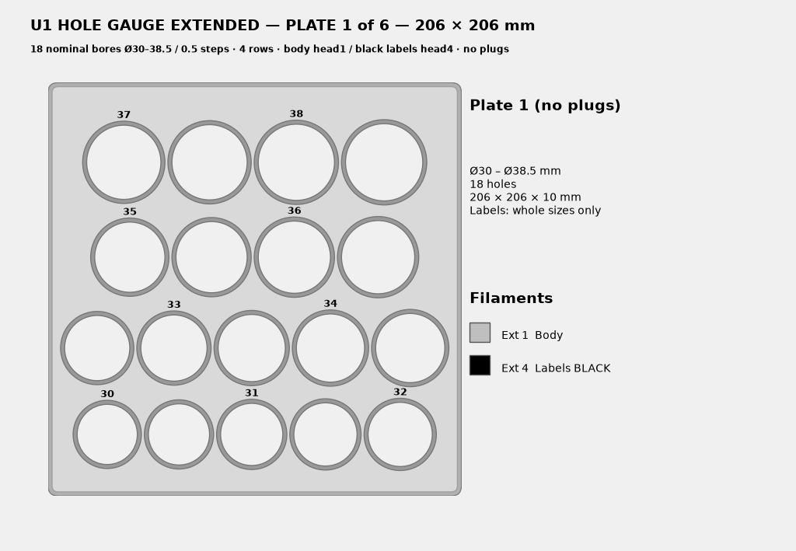
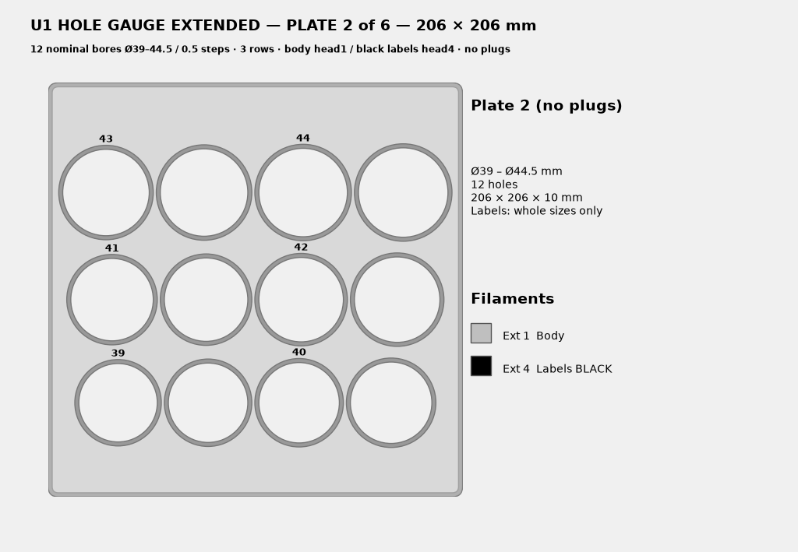
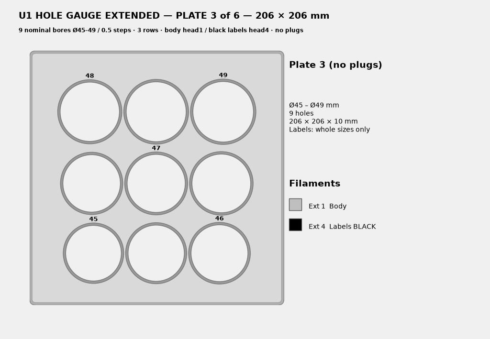
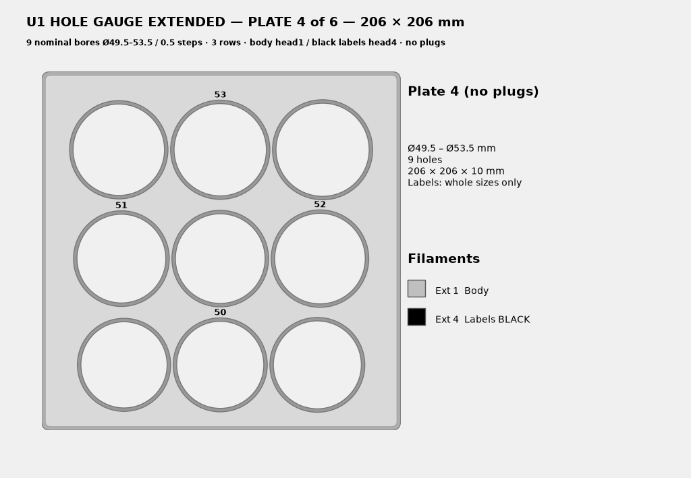
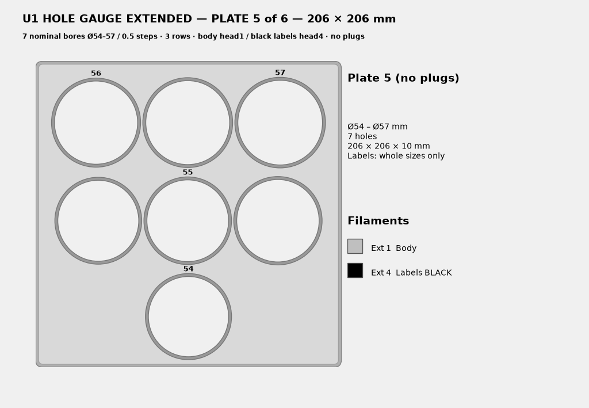
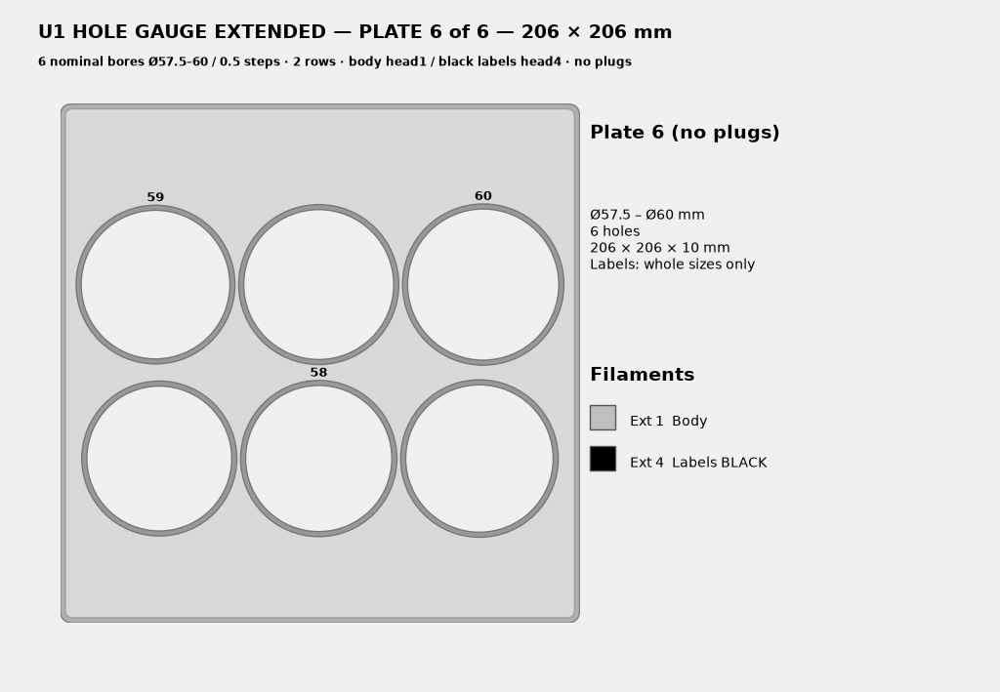

# Hole sizing gauges

Print a plate, then drop a socket, driver bit, or dowel into the holes until you find the one that is snug: it lifts out cleanly and does not rattle. Enter that hole's diameter as `hole_diameter_mm` in the [SocketBin sockets file](../README.md#sockets-file). The label on the plate is the size to write down. Half-millimetre holes are unlabeled; they sit between the labeled whole sizes.

Every plate is **206 × 206 × 10 mm**. Holes step by **0.5 mm**. Labels are black and inlaid, and only whole-millimetre sizes are labeled. The 3MF files are multi-material, made for a Snapmaker U1: the body is extruder 1 and the labels are extruder 4. A single-color printer can print both parts in one filament.

## Plates

| Plate | Diameters | Holes | Plugs | Print file |
|---|---|---|---|---|
| v12 | Ø6–29.5 mm | 48 | 8 plugs, Ø6–20 mm even, nested in the largest holes | [`v12/hole_gauge_v12_plate_only.3mf`](v12/hole_gauge_v12_plate_only.3mf) or [`v12/hole_gauge_v12_plate_with_plugs.3mf`](v12/hole_gauge_v12_plate_with_plugs.3mf) |
| Extended 1 | Ø30–38.5 mm | 18 | none | [`Extended-30-60/hole_gauge_ext_plate1_30-38p5.3mf`](Extended-30-60/hole_gauge_ext_plate1_30-38p5.3mf) |
| Extended 2 | Ø39–44.5 mm | 12 | none | [`Extended-30-60/hole_gauge_ext_plate2_39-44p5.3mf`](Extended-30-60/hole_gauge_ext_plate2_39-44p5.3mf) |
| Extended 3 | Ø45–49 mm | 9 | none | [`Extended-30-60/hole_gauge_ext_plate3_45-49.3mf`](Extended-30-60/hole_gauge_ext_plate3_45-49.3mf) |
| Extended 4 | Ø49.5–53.5 mm | 9 | none | [`Extended-30-60/hole_gauge_ext_plate4_49p5-53p5.3mf`](Extended-30-60/hole_gauge_ext_plate4_49p5-53p5.3mf) |
| Extended 5 | Ø54–57 mm | 7 | none | [`Extended-30-60/hole_gauge_ext_plate5_54-57.3mf`](Extended-30-60/hole_gauge_ext_plate5_54-57.3mf) |
| Extended 6 | Ø57.5–60 mm | 6 | none | [`Extended-30-60/hole_gauge_ext_plate6_57p5-60.3mf`](Extended-30-60/hole_gauge_ext_plate6_57p5-60.3mf) |

Together the plates cover **Ø6–60 mm** in 0.5 mm steps (48 holes on v12, then 61 holes across the six extended plates).

**v12** uses straight ascending rows, smallest holes at the bottom. `hole_gauge_v12.step` is the same plate for Fusion. Hole layout, plugs, and print notes are in [`v12/NOTES.md`](v12/NOTES.md).

**Extended plates** have no plugs. Each folder entry also includes a `.step`, a body `.stl`, a labels `.stl`, and a preview `.png`. Row counts come from fitting the holes on the 206 mm plate, so later plates have fewer, larger holes.

## Printing

- The plate is 10 mm tall. Print it flat, floor on the bed, cavity up. No supports.
- Labels are a second filament, inlaid in black. In each 3MF, **Body is extruder 1** and **Labels are extruder 4**. On a Snapmaker U1 that is head 1 and head 4. In another slicer, assign the Labels part to your label filament.
- Keep **XY hole compensation at 0**. A compensation value changes every bore, and the number on the plate no longer matches the hole you measured.
- PLA or PETG is fine. Use a fine layer height (0.2 mm or finer) so the inlaid digits stay readable.
- Load the 3MF as one multi-part object and keep the body and labels in the same place. The separate STL pair is there when you want to assign colors yourself.

## v12 plugs

`hole_gauge_v12_plate_only.3mf` is the gauge plate alone.

`hole_gauge_v12_plate_with_plugs.3mf` is the same plate with eight plugs nested in the largest holes: Plug 6, 8, 10, 12, 14, 16, 18, and 20. Each plug has its own body (extruder 1) and label (extruder 4). Print that file when you want the plugs in the same job. The plate-only file is the one to use as a measuring gauge if you do not need the plugs.

## Extended plate previews

### Plate 1 — Ø30–38.5 mm, 18 holes



### Plate 2 — Ø39–44.5 mm, 12 holes



### Plate 3 — Ø45–49 mm, 9 holes



### Plate 4 — Ø49.5–53.5 mm, 9 holes



### Plate 5 — Ø54–57 mm, 7 holes



### Plate 6 — Ø57.5–60 mm, 6 holes



## Regenerating the extended plates

[`Extended-30-60/build_ext.py`](Extended-30-60/build_ext.py) and [`layout.py`](Extended-30-60/layout.py) are the CadQuery generator for the six extended plates. They stay side by side so `build_ext.py` can import `layout`. From that folder:

```bash
python build_ext.py
```

The script writes a fresh set of STEP, STL, 3MF, PNG, and `verification-ext.json` files into `out/`. The plates already in `Extended-30-60/` are that generated set. Regenerating needs CadQuery, trimesh, NumPy, and matplotlib. `verification-ext.json` records each plate's hole count, row ranges, and mesh checks.
